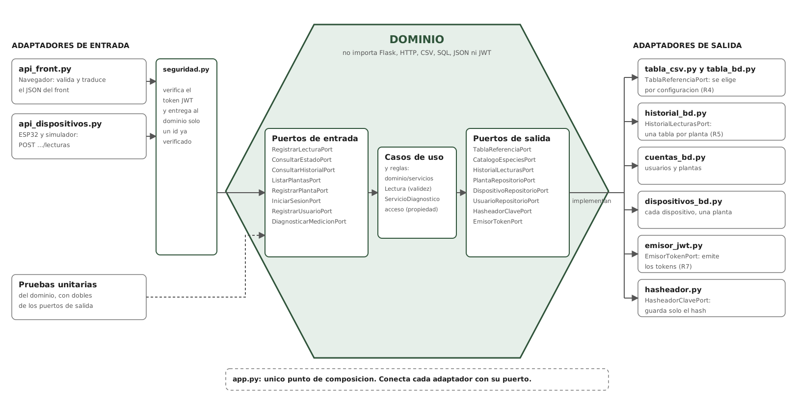

# Proyecto Matera · Fase 2 · Documento de arquitectura

Arquitectura de Software · Universidad Sergio Arboleda · Entrega 2 · Integrantes: _completar_

## 1. Diagrama hexagonal



El dominio define los puertos; los adaptadores los cumplen y las dependencias apuntan hacia adentro. Los adaptadores de entrada traducen lo que llega de afuera, y los de salida implementan lo que el dominio necesita.

## 2. Puertos y adaptadores

| Puerto | Tipo | Adaptador | Requisito |
|--------------------------------|--------------|------------------------------------|------------------|
| `RegistrarLecturaPort` | entrada | `api_dispositivos.py` (ESP32 y simulador) | R2 |
| `ConsultarEstadoPort`, `ConsultarHistorialPort`, `ListarPlantasPort` | entrada | `api_front.py` | R5, R6 |
| `DiagnosticarMedicionPort`, `ListarEspeciesPort` | entrada | `api_front.py` | R1 |
| `RegistrarUsuarioPort`, `IniciarSesionPort`, `RegistrarPlantaPort` | entrada | `api_front.py` | R7 |
| `TablaReferenciaPort`, `CatalogoEspeciesPort` | salida | `tabla_csv.py`, `tabla_bd.py` | R4 |
| `HistorialLecturasPort` | salida | `historial_bd.py` (una tabla por planta) | R5 |
| `PlantaRepositorioPort`, `UsuarioRepositorioPort` | salida | `cuentas_bd.py` | R7 |
| `DispositivoRepositorioPort` | salida | `dispositivos_bd.py` | R2, R7 |
| `HasheadorClavePort` | salida | `hasheador.py` | R7 |
| `EmisorTokenPort` | salida | `emisor_jwt.py` | R7 |

Base de datos (SQLite): `usuarios`, `especies`, `plantas`, `dispositivos` y una tabla `lecturas_MAT_XXXXXX` por cada planta, que se crea al registrarla. El nombre de la tabla solo se arma con un id que cumpla el patrón `MAT-XXXXXX`.

## 3. Dónde se emite y dónde se verifica el JWT

- **Se emite** en el dominio solo a través del puerto `EmisorTokenPort`. `IniciarSesion` pide un token de usuario y `RegistrarPlanta` pide el token del dispositivo. Quien lo crea es `emisor_jwt.py` (PyJWT, HS256).
- **Se verifica** en el adaptador de entrada `seguridad.py`, con los decoradores `requiere_usuario` y `requiere_dispositivo`. El verificador se inyecta desde `app.py`.
- El caso de uso recibe un `usuario_id` o un `dispositivo_id` ya verificado. Nunca ve el token ni las cabeceras, y la palabra `jwt` no aparece en `dominio/`.

| Token | Contenido | Dura | Alcance |
|----------------|----------------------------|----------|----------------------------------------------|
| Usuario | `tipo=usuario`, `sub=id` | 1 hora | Consultar sus plantas, su estado y su historial |
| Dispositivo | `tipo=dispositivo`, `sub=id del dispositivo` | 90 días | Solo `POST /api/dispositivos/{id}/lecturas` de su propia matera |

Un token de usuario no sirve en la ruta del dispositivo (401), uno de dispositivo no sirve en las del front (401) y un dispositivo no puede reportar por otro (403). La regla "un usuario solo ve sus plantas" sí es del dominio (`servicios/acceso.py`): pedir una planta ajena lanza `AccesoDenegadoError`, que el adaptador traduce a 403.

## 4. Principios SOLID en el código

**Inversión de dependencias (D).** El caso de uso depende de interfaces que declara el dominio, no de CSV ni de SQL. Quien decide la implementación es `app.py`.

```python
class RegistrarLectura(RegistrarLecturaPort):
    def __init__(self, dispositivos: DispositivoRepositorioPort, plantas: PlantaRepositorioPort,
                 tabla: TablaReferenciaPort, historial: HistorialLecturasPort,
                 servicio: ServicioDiagnostico): ...
```

**Abierto/cerrado (O).** Cambiar CSV por BD o agregar el ESP32 es agregar un adaptador, sin modificar el dominio.

```python
if tipo_tabla == "bd":
    tabla = TablaBD(ruta_bd)
elif tipo_tabla == "csv":
    tabla = tabla_csv
```

**Segregación de interfaces (I).** Los puertos son pequeños. `ConsultarHistorial` solo necesita dos, y no conoce usuarios, dispositivos ni tokens.

```python
class ConsultarHistorial(ConsultarHistorialPort):
    def __init__(self, plantas: PlantaRepositorioPort, historial: HistorialLecturasPort): ...
```

**Responsabilidad única (S).** El adaptador del dispositivo solo traduce y revisa el alcance del token; qué es una lectura válida lo decide el dominio.

```python
lectura = dtos.lectura_desde_request(request.get_json(silent=True) or {}, dispositivo_id)
diagnostico = registrar_lectura.ejecutar(dispositivo_id, lectura)
```
```python
@dataclass(frozen=True)
class Lectura:
    def __post_init__(self):
        validar_valores(self.humedad, self.luz, self.temperatura)
```

## 5. Prueba de cambio

Commit que agrega el adaptador de dispositivos y el simulador: **[pegar aquí el enlace al commit "Agregar adaptador de dispositivos y simulador del ESP32"]**.

Ese commit toca tres archivos: `api_dispositivos.py`, `simulador_esp32.py` y `app.py`, que es la composición y no el dominio. No modifica ningún archivo de `servidor/dominio/`. Se comprueba con `git show --stat <hash>`. El script `utilidades/crear_historial_git.py` arma los commits en ese orden y falla si el del dispositivo toca el dominio. CSV y BD se intercambian con `MATERA_TABLA=csv` o `MATERA_TABLA=bd`.

## 6. Qué cambiaría si las lecturas llegaran por MQTT

El dominio, los puertos y los adaptadores de salida no cambian. MQTT es otra forma de entrada, así que se agrega un adaptador de entrada.

| Qué | Cambio |
|------------------------|----------------------------------------------------------------------------|
| Nuevo archivo | `adaptadores/entrada/mqtt_dispositivos.py`: se suscribe a `matera/dispositivos/+/lecturas`, convierte el mensaje con `dtos.lectura_desde_request` y llama a `RegistrarLecturaPort.ejecutar`, igual que `api_dispositivos.py` |
| `app.py` | Unas líneas para crear el suscriptor con el mismo `RegistrarLectura` ya armado |
| `requirements.txt` | La librería cliente de MQTT |
| Seguridad | Las credenciales del broker o un token en el mensaje, que se verifica con el mismo `EmisorJWT.verificar` dentro del adaptador. El dominio sigue sin conocer tokens |
| Dominio, puertos de salida, historial, front | Sin cambios |

Lo que sí exige pensar: MQTT puede entregar un mensaje más de una vez o fuera de orden. Como cada lectura trae su marca de tiempo y el historial ordena por ella, el orden se mantiene; evitar duplicados exactos sería una regla nueva que se agregaría al historial, no al adaptador.

## 7. Cómo se comprueban las reglas no negociables

| Regla | Comprobación |
|----------------------------------------|------------------------------------------------------------|
| El dominio no importa Flask, HTTP, CSV, SQL ni JSON | `utilidades/verificar_reglas.py` y `pruebas/prueba_aislamiento_dominio.py` |
| Puertos definidos por el dominio | Clases abstractas en `dominio/puertos/` |
| Un solo punto de composición | `app.py`; el verificador falla si un adaptador se instancia en otro archivo |
| El dominio no conoce JWT | Ningún `jwt` en `dominio/`; el verificador lo comprueba |
| Pruebas del dominio sin servidor, archivos ni BD | 36 pruebas con dobles en `pruebas/`; siguen pasando con `adaptadores/` borrada |
